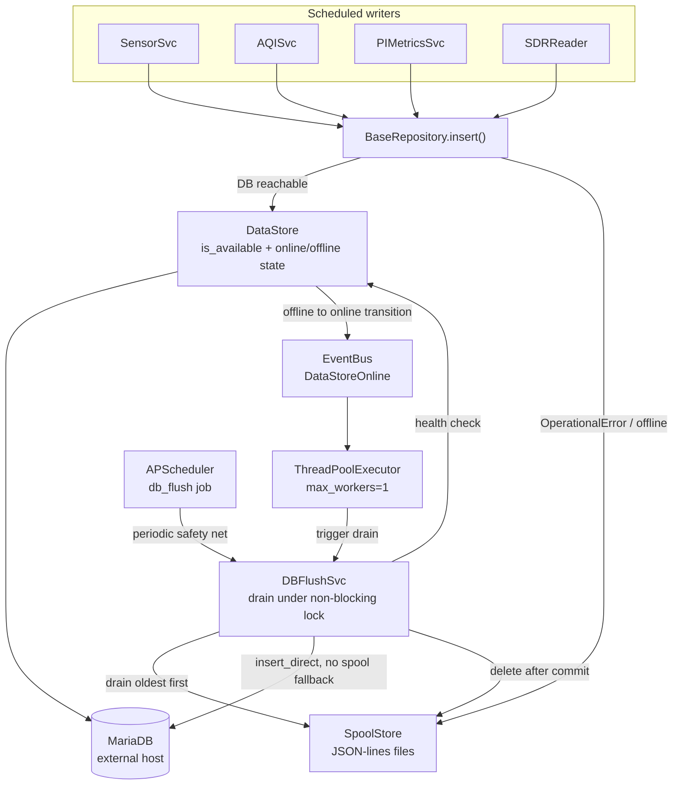

# Offline Spool Store, UTC Convention, and DB Backup Removal

Prepares WeatherWatch for the database moving to an external host. The move itself is owned by
[home_server `weather-mariadb-migration`](https://github.com/tim-oe/home_server/blob/main/.cursor/plan/weather-mariadb-migration.md);
this plan is the station-side work that migration surfaced or made necessary.

Three pieces, in this order:

1. **Remove the in-app DB backup.** home_server's offen sidecar owns dumps now.
2. **Adopt piSolar's UTC convention.** The migration audit found an annual DST defect and a hidden dependency on the station's system timezone.
3. **Add an offline spool.** With the database across the LAN, an unreachable DB must no longer mean lost readings.

The ordering is deliberate and each step shrinks the next. Removing the backup deletes `BackupRange.py` (one of the UTC read-side touchpoints) and frees `BaseRepository` of its DB-dependent constructor. Doing the UTC change before the spool means the spool's on-disk timestamp semantics are written once against the final convention, and there is never a window where a spool file straddles a change in what a stored datetime means.

## Decisions locked in

- Local store format: **JSON-lines spool files** on disk, one directory per table, serialized from the entity objects themselves via the SQLAlchemy mapper.
- Offline tolerance: **full** - `sensor.py` boots and collects even if the DB is unreachable at startup.
- Reads during an outage: **degrade gracefully** - return `None`/`[]`, callers log a warning and skip.
- Replay: **event-triggered plus a periodic `db_flush` APScheduler job**. An offline-to-online transition on the first successful write fires a `DataStoreOnline` event that kicks an immediate drain; the scheduled job is the safety net. Both drain oldest-first and delete only after a confirmed commit.
- Backup removal: **DB backup only**. Camera/timelapse rsync and local purge stay in `BackupSvc`.
- UTC convention: **adopt piSolar's pattern and remove `LocalToUTCDateTime`** rather than reducing it. Every write site produces naive UTC via the already-existing `Converter.utcnow()`, so the decorator has nothing left to do.

## Current blockers to offline operation

Two constructors need a live DB connection today, so the process cannot even start during an outage:

- `BaseRepository.__init__` calls `DataStore.get_table_def()`, which runs `metadata.reflect(engine)`:

```39:45:weatherwatch/repository/BaseRepository.py
        self._table: Table = self._datastore.get_table_def(self._entity.__tablename__)

        self._columns = {}
        c: Column

        for c in self._table.columns:
            self._columns[c.name] = c.type
```

- `SchedulerSvc.__init__` builds a MariaDB-backed job store:

```113:114:weatherwatch/svc/SchedulerSvc.py
        self._jobstore = SQLAlchemyJobStore(url=AppConfig().database.url)
        jobstores = {"default": self._jobstore}
```

Removing the DB backup is what unblocks the first one: `get_insert()`/`get_value()` exist only to serve the repository `backup()` methods, and they are the only consumers of `_table`/`_columns`.

## Architecture



---

## Phase 1: Remove the database backup

Delete outright:
- [weatherwatch/backup/BackupRange.py](weatherwatch/backup/BackupRange.py) and the `weatherwatch/backup/` package
- [tests/backup/test_BackupRangeTest.py](tests/backup/test_BackupRangeTest.py) and `tests/backup/`

Edit [weatherwatch/svc/BackupSvc.py](weatherwatch/svc/BackupSvc.py):
- Drop `db()`, `outdoor_sensor_backup()`, `indoor_sensor_backup()`, `aqi_sensor_backup()`, `db_backup()`, `archive_monthly()` (lines 97-207)
- Drop `_backup_pool`, `_db_m_dir`, `_db_w_dir` from the ctor and the `BackupRange`, `ThreadPoolExecutor`, `concurrent`, `functools`, `glob`, `zipfile`, and three repository imports
- Keep `camera()`, `backup_stills()`, `backup_vids()`, `Rsync`

Edit [weatherwatch/svc/SchedulerSvc.py](weatherwatch/svc/SchedulerSvc.py):
- Remove `db_backup()` entry point (lines 61-66), `DB_BACKUP_JOB`, `init_backup_db()`, and its `__init__` call

Edit repositories - remove the `backup()` method from [OutdoorSensorRepository.py](weatherwatch/repository/OutdoorSensorRepository.py), [IndoorSensorRepository.py](weatherwatch/repository/IndoorSensorRepository.py), [AQISensorRepository.py](weatherwatch/repository/AQISensorRepository.py), [LightSensorRepository.py](weatherwatch/repository/LightSensorRepository.py). Then remove `get_insert()` and `get_value()` from [BaseRepository.py](weatherwatch/repository/BaseRepository.py) (lines 155-204) and the now-unused `insert`/`Numeric`/`Integer`/`DateTime`/`json` imports.

Config cleanup:
- [weatherwatch/conf/BackupConfig.py](weatherwatch/conf/BackupConfig.py) - remove `DB_KEY`, `WEEKLY_OLD`, `db_enable`, `db_weekly_old`
- [config/weatherwatch.yml](config/weatherwatch.yml) - remove the `backup.db` block (lines 18-20) and `scheduler.db_backup` (lines 80-81)
- [weatherwatch/conf/SchedulerConfig.py](weatherwatch/conf/SchedulerConfig.py) - remove `DB_BACKUP_KEY` and `db_back_hour`
- [weatherwatch/conf/DatabaseConfig.py](weatherwatch/conf/DatabaseConfig.py) - remove the orphan `BACKUP_KEY`/`ENABLE_KEY`/`FOLDER_KEY` constants and `backup_enable`/`backup_folder` (lines 29-31, 94-109); these read `database.backup.*`, which is not in the YAML at all

Test cleanup: [tests/svc/test_BackupSvcTest.py](tests/svc/test_BackupSvcTest.py) (drop the two DB tests, keep file tests), [tests/svc/test_SchedulerSvcTest.py](tests/svc/test_SchedulerSvcTest.py), [tests/conf/test_MiscConfigTest.py](tests/conf/test_MiscConfigTest.py), [tests/conf/test_DatabaseConfigTest.py](tests/conf/test_DatabaseConfigTest.py), the four `test_*RepositoryTest.py` backup tests, and `test_get_value_false_bool_returns_zero` in [tests/repository/test_OutdoorSensorRepositoryTest.py](tests/repository/test_OutdoorSensorRepositoryTest.py).

Also update the feature bullet in [README.md](README.md) (line 31) and note in `docs/` that DB backup is owned by home_server.

---

## Phase 2: Adopt piSolar's UTC convention

Analysis and rationale live in the migration plan's
[handoff section](https://github.com/tim-oe/home_server/blob/main/.cursor/plan/weather-mariadb-migration.md#handoff-weatherwatch-should-adopt-pisolars-utc-convention).
Every claim in it was re-verified against the current tree while writing this plan. Summary of what is wrong today:

**The DST defect.** `LocalToUTCDateTime.process_bind_param` uses `localize(value, is_dst=False)`. On the first Sunday of November, 01:00-01:59 local occurs twice in America/Chicago and `is_dst=False` resolves both passes to standard time:

- 01:30 CDT (first pass) actually happened at 06:30 UTC but is stored as **07:30 UTC**
- 01:30 CST (second pass) actually happened at 07:30 UTC and is stored as 07:30 UTC

So first-pass readings are written an hour late *and* collide with the second pass on `UNIQUE KEY (read_time, sensor_id)`. `light_sensor` has `UNIQUE KEY (read_time)` with no sensor discriminator, so it is tighter still. `V1_2_1__outdoor_sensor.sql` documents this behaviour and judges it acceptable, but it was reasoning about a one-off historic backfill - the same code runs in production every November.

Separately, `Converter.to_utc` uses `is_dst=None`, which **raises** `AmbiguousTimeError` instead of silently shifting. Its only caller is `WUClient.py` line 50, so Weather Underground posts throw during that hour rather than mis-dating. Spring-forward needs no handling: `datetime.now()` never returns a local time that does not exist.

**The hidden host dependency.** `_local_tz` is resolved from the *application host's* zone at import time, so the station's system timezone is the conversion factor for every row written. piSolar reaches the same bytes on disk with no host dependency at all, which is why it is the reference implementation rather than WeatherWatch.

### 2a. Write side

Generate UTC at the source. `Converter.utcnow()` already exists, already returns exactly the naive UTC value needed, and is **dead code** - referenced only by `tests/util/test_ConverterTest.py`. That strongly suggests this direction was chosen once and left half-finished:

```117:122:weatherwatch/util/Converter.py
    def utcnow() -> datetime:
        """
        current time as a naive UTC datetime for DB storage
        :return: naive UTC datetime
        """
        return datetime.now(timezone.utc).replace(tzinfo=None)
```

Replace `datetime.now()` with `Converter.utcnow()` at:
- [weatherwatch/svc/SensorSvc.py](weatherwatch/svc/SensorSvc.py) line 73 - the light sensor path
- [weatherwatch/svc/AQISvc.py](weatherwatch/svc/AQISvc.py) line 56
- [weatherwatch/svc/PIMetricsSvc.py](weatherwatch/svc/PIMetricsSvc.py) line 106
- [weatherwatch/sensor/sdr/SDRReader.py](weatherwatch/sensor/sdr/SDRReader.py) lines 311 and 326 - `start_time` and `end_time`

**The SDR reading timestamp is the one case the app cannot disambiguate on its own.** `SensorSvc.set_base_data` copies `data.time_stamp` straight through, and that value comes from rtl_433's reported `time` field parsed as naive local wall clock:

```72:72:weatherwatch/sensor/sdr/BaseData.py
            o.time_stamp = datetime.strptime(raw["time"], BaseData.DATE_FORMAT)
```

with `DATE_FORMAT = "%Y-%m-%d %H:%M:%S"`. During the fall-back hour that string is genuinely ambiguous and no client-side rule recovers the right answer - the information is not in the data. Fix it at the source instead: add `-M utc` to `SDRReader.CMD_BASE` so rtl_433 emits UTC directly, and update `DATE_FORMAT` to match.

Two things to handle rather than assume:
- **Verify the actual output format** on the deployed rtl_433 before committing to a parse string; `-M utc` switches it to ISO-8601 with a `Z` suffix rather than the current space-separated form.
- The `time` value inside the stored `raw` JSON column changes with it. `raw` is an archive column so nothing reads it structurally, and having it agree with `read_time` is an improvement - but the JSON fixtures in `data/` and `tests/data/` need regenerating to match.

### 2b. Persistence layer

**Remove `LocalToUTCDateTime`** and let the time columns be plain `DATETIME(6)`, as piSolar's models are. With every write site producing naive UTC, the decorator has nothing left to do, and removing it is what makes the Phase 4 codec fully generic (see below). It is referenced by `BaseSensor`, `AQISensor`, `LightSensor`, `PIMetrics` and `SDRMetricts`.

`tests/entity/test_LocalToUTCDateTimeTest.py` asserts the convention being replaced - including `test_bind_dst_fallback_picks_cst`, which encodes the bug as expected behaviour - so it goes with the decorator. Its offset-sanity cases are worth keeping in spirit as tests on the new local-day boundary helper.

**No schema migration.** Stored values are UTC today and stay UTC; this changes only which side of the persistence boundary performs the conversion. Nothing in `sql/schema/` changes and no data is rewritten. Rows already corrupted by past DST collisions are not recoverable and are out of scope.

### 2c. Read side

This is the part with real size. Today the decorator converts *filter bounds* as well as stored values, so local-date filtering is self-consistent by accident. Once reads return UTC, every local-day boundary has to be computed explicitly.

Add a single tested helper rather than repeating the arithmetic at each call site - something like `Converter.local_day_bounds(d) -> (utc_start, utc_end)` - then use it at:
- [weatherwatch/dashboard/page/OutdoorSensorPage.py](weatherwatch/dashboard/page/OutdoorSensorPage.py) lines 49 and 53 - `get_days_rainfall(date.today())` and a 7-day window
- [weatherwatch/dashboard/page/IndoorSensorPage.py](weatherwatch/dashboard/page/IndoorSensorPage.py) line 46 - 7-day window
- [weatherwatch/dashboard/page/AirQualityPage.py](weatherwatch/dashboard/page/AirQualityPage.py) line 39 - 7-day window
- [weatherwatch/dashboard/page/CameraPage.py](weatherwatch/dashboard/page/CameraPage.py) line 51 - 1-day window
- [weatherwatch/svc/WUSvc.py](weatherwatch/svc/WUSvc.py) line 60 - `get_days_rainfall(date.today())`, a local-day rainfall total

A local day is not a UTC day, so getting this wrong shifts totals by a few hours' worth of readings rather than failing loudly. That is the argument for one helper with its own tests instead of five open-coded conversions.

`BaseRepository._coerce_to_datetime` exists solely to feed bare `date` objects into the decorator and should become unnecessary once callers pass explicit UTC bounds - remove it if nothing else needs it.

Two things that look like read-side work but are not:
- `weatherwatch/backup/BackupRange.py` is on the handoff's list, but Phase 1 deletes it, so it drops off entirely.
- `Timelapse.py` line 56 and `SampleLoader.py` use `date.today()` for file globbing and dev fixtures, not DB filters.

`aqi_clean` needs no attention - it is `id`-ordered throughout with no time functions.

### 2d. Documentation correctness

- `types.py` carries a stale docstring claiming "On read: returns the value as-is (naive UTC)" while `process_result_value` converts UTC back to local. It goes with the file, but note it so the same wording does not get carried into whatever replaces it.
- `sql/schema/V1_3_6__sonic_reading.sql` says SonicModBus "will be updated to set `read_time` explicitly from the application layer via the `LocalToUTCDateTime` TypeDecorator, consistent with the WeatherWatch UTC storage convention." That convention is the one being replaced, so correct the comment to point at piSolar's pattern before it propagates into a third writer. This is also on the migration's Phase 4 list.

---

## Phase 3: Make startup DB-independent

[weatherwatch/repository/DataStore.py](weatherwatch/repository/DataStore.py):
- Delete `get_table_def()` (reflection). Update [tests/repository/test_DataStoreTest.py](tests/repository/test_DataStoreTest.py).
- Add `connect_args={"connect_timeout": n}` and `pool_recycle` to `create_engine`. Critical now that the DB is across the network - a dead host would otherwise block a sensor read for the full TCP timeout. Both `mariadbconnector` (prod) and `pymysql` (tests) accept `connect_timeout`.
- Add `is_available() -> bool` running `SELECT 1`.
- Add offline-state tracking (`_offline_until`) so a long outage does not pay a connect timeout on every single insert; sensor handlers fire several times per cycle.
- Own the online/offline **state transition**: `mark_offline()` and `mark_online()`, where `mark_online()` fires the `DataStoreOnline` event only when the previous state was offline (see Phase 7). Guard the state with a `threading.Lock` - writes arrive from the SDR data pool, the light read, and the scheduler threads concurrently.
- While in here, fix the swapped arguments - `max_overflow` is currently fed `pool_size` and vice versa (lines 30-31).

[weatherwatch/repository/BaseRepository.py](weatherwatch/repository/BaseRepository.py):
- Replace the reflected table with the declarative one, which exists at import time with no DB round trip:

```python
self._table: Table = self._entity.__table__
self._columns = {c.name: c.type for c in self._table.columns}
```

[weatherwatch/svc/SchedulerSvc.py](weatherwatch/svc/SchedulerSvc.py):
- Swap `SQLAlchemyJobStore` for `MemoryJobStore`. Every job is re-added on each startup with `replace_existing=True`, so MariaDB persistence buys nothing except the stale-job problem the `remove_job()` calls work around.
- With a memory store those `else: self._jobstore.remove_job(...)` branches in `init_camera`, `init_timelapse`, `init_backup_file`, `init_aqi`, `init_wu` become dead - remove them along with `self._jobstore` and the `JobLookupError` import, and update the corresponding tests.
- The `apscheduler_jobs` table then goes unused. Leave the migration in place; dropping it belongs to home_server.

---

## Phase 4: Local spool store

New `weatherwatch/spool/SpoolStore.py`. Layout: `{spool.folder}/{table_name}/{YYYYMMDD}.jsonl`, append-only, one JSON object per line. Each line is an envelope so a drained line rebuilds a fully typed entity instance:

```json
{"entity": "OutdoorSensor", "spooled_at": "2026-09-02T21:05:11+00:00", "data": { }}
```

### Entity serialization

Serialization is driven off the entity objects themselves, in a new `weatherwatch/spool/EntityCodec.py` (or as `to_json_dict()`/`from_json_dict()` on a small mixin shared by `BaseSensor` and `BaseEntity`). One generic codec covers every entity; no per-table field lists to keep in sync.

**Do not use `dataclasses.asdict()`.** The entity classes are inconsistently decorated and the dataclass field set is wrong:

- `OutdoorSensor`, `IndoorSensor`, `LightSensor`, `PIMetrics`, `SDRMetrics` carry `@dataclass`, but their bases (`BaseSensor`, `BaseEntity`) do not. Dataclass fields therefore cover only the subclass columns - `dataclasses.fields(OutdoorSensor)` returns just the 8 outdoor columns and **silently drops `read_time`, `battery_ok`, `sensor_id`, `temperature_f`, `humidity`, and `raw`**.
- `AQISensor` has no `@dataclass` at all, so `asdict()` raises `TypeError`.

The SQLAlchemy mapper has the complete and correct set for all six entities with no DB round trip, so drive the codec off `cls.__table__.columns` (verified against all entity types):

```python
# encode
data = {c.name: encode(getattr(o, c.name)) for c in type(o).__table__.columns if c.name != "id"}

# decode
ent = cls()
for c in cls.__table__.columns:
    if c.name in data and c.name != "id":
        setattr(ent, c.name, coerce(c.type, data[c.name]))
```

`id` is excluded in both directions - it is autoincrement and must not be replayed.

Coercion keys off `column.type.python_type`, which resolves cleanly for every column type in use: `Numeric` to `Decimal`, `Integer` to `int`, `Boolean` to `bool`, `JSON` to `dict`, `DateTime` to `datetime`. **This is the payoff from doing Phase 2 first.** While `LocalToUTCDateTime` is still in place, `python_type` raises `NotImplementedError` on every time column because the `TypeDecorator` does not declare it, and the codec would need either a `python_type` override on the decorator or a `TypeDecorator`-unwrapping special case. Removing the decorator in Phase 2b makes the codec a plain generic loop.

On the wire, `Decimal` encodes as a string (never a float - these are rainfall and pressure values) and `datetime` as `isoformat()` **with an explicit `+00:00` offset**. The stored values are naive UTC after Phase 2, so the offset is redundant in principle; write it anyway so a spool file is self-describing rather than depending on the reader knowing the convention. This is the same choice piSolar makes in its own offline spool (`services/sqlite_consumer.py` stores `datetime.now(timezone.utc)`). Decode parses the offset and strips `tzinfo` at the boundary, matching `solar_model.py`. `raw` is already a dict and passes straight through.

### Drain safety

The flush job and the writers touch the same directory, so:
1. Atomically `rename` the active file to `{name}.draining`, which sends new appends to a fresh file.
2. Replay lines from the `.draining` file in order.
3. Delete the file only once every line is committed; on partial failure rewrite the remainder to a temp file and `os.replace` it back.
4. On startup, adopt any leftover `.draining` files (crash recovery).

Also add a retention guard - purge or alert past `max_age_days` / a size threshold, using the existing `Emailer` for the alert, so a multi-week outage cannot fill the Pi's disk.

### Config

New `weatherwatch/conf/SpoolConfig.py` plus registration in [weatherwatch/conf/AppConfig.py](weatherwatch/conf/AppConfig.py) (following the existing `BackupConfig` pattern), and a new `spool:` block in [config/weatherwatch.yml](config/weatherwatch.yml):

```yaml
spool:
  enable: !ENV tag:yaml.org,2002:bool ${WW_SPOOL_ENABLE:true}
  folder: !ENV ${WW_SPOOL_FOLDER:spool}
  max_age_days: !ENV tag:yaml.org,2002:int ${WW_SPOOL_MAX_AGE:30}
  warn_mb: !ENV tag:yaml.org,2002:int ${WW_SPOOL_WARN_MB:256}
```

Add `WW_SPOOL_FOLDER` to [systemd/weatherwatch.service](systemd/weatherwatch.service) pointing at local storage (for example `/var/lib/weatherwatch/spool`) - it must not live on the NAS mount, since the whole point is surviving a network outage.

---

## Phase 5: Route writes through the spool

Wrap the single write funnel in [weatherwatch/repository/BaseRepository.py](weatherwatch/repository/BaseRepository.py):

```70:82:weatherwatch/repository/BaseRepository.py
    def insert(self, o: T):
        """
        insert new object
        :param self: this
        :param o: the object to insert
        """
        session: Session = self._datastore.session
        try:
            session.add(o)
            session.commit()
            session.refresh(o)
        finally:
            session.close()
```

becomes:

- If the datastore is known-offline, spool immediately and return.
- Otherwise attempt the commit. On success call `DataStore.mark_online()`, which is a no-op unless it is an offline-to-online transition.
- On `OperationalError`/`SQLAlchemyError`, call `DataStore.mark_offline()`, spool the entity, and log a warning rather than re-raising.

Every production writer already funnels through here - `SensorSvc` (lines 82, 99, 143), `AQISvc` (line 58), `PIMetricsSvc` (line 108), `SDRReader` (line 379) - so no call-site changes are needed for buffering.

Also add `insert_direct(o)` alongside it: the same commit with **no** spool fallback, raising on failure. The flush service must use this, because a failure mid-replay through the normal `insert()` would spool a row that is already sitting in the spool and duplicate it.

---

## Phase 6: Degrade reads

Add a `@db_read(default=None)` decorator in `weatherwatch/repository/` and apply it to the read methods on all six repositories (`find_by_id`, `top`, `find_latest`, `find_greater_than_read_time`, `get_days_rainfall`) so a DB error logs a warning and returns the default instead of propagating.

Guard the callers:
- [weatherwatch/svc/WUSvc.py](weatherwatch/svc/WUSvc.py) - return early with a warning when `in_data` or `out_data` is `None`. Important: the current broad `except Exception` at line 85 fires an error email, so without this guard an outage would email on every WU interval.
- [weatherwatch/svc/CameraSvc.py](weatherwatch/svc/CameraSvc.py) line 56 - skip weather EXIF tags when the latest reading is `None`; still take the photo.
- [weatherwatch/svc/AQISvc.py](weatherwatch/svc/AQISvc.py) line 62 - skip the `aqi_clean` stored procedure while offline.
- Dashboard pages [OutdoorSensorPage.py](weatherwatch/dashboard/page/OutdoorSensorPage.py), [IndoorSensorPage.py](weatherwatch/dashboard/page/IndoorSensorPage.py), [AirQualityPage.py](weatherwatch/dashboard/page/AirQualityPage.py) - render an empty/unavailable state rather than throwing.

---

## Phase 7: Flush service

New `weatherwatch/svc/DBFlushSvc.py` with a `process()` entry point, following the existing service pattern:
1. Acquire a non-blocking re-entrancy lock; bail out if a drain is already running (see below).
2. Return immediately unless `DataStore.is_available()`.
3. Drain each table directory oldest-file-first, oldest-line-first, replaying through `insert_direct()`.
4. Treat `IntegrityError` on replay as delivered and drop the line - the sensor tables have unique constraints on `(read_time, sensor_id[, channel])`, so a crash mid-drain must not stall the queue forever. Log these at warning with a running count rather than silently: after Phase 2 a duplicate should only ever mean an interrupted drain, so a nonzero count for any other reason is worth seeing.
5. Log a summary (rows replayed per table, remaining depth).

It also needs a table-name to (entity class, repository) map, which doubles as the class resolver for the spool envelope's `entity` field and marks `outdoor_sensor` as needing rain-delta recomputation.

### Two triggers

**Event trigger.** The codebase already has `python-event-bus`, and `SDRReader` establishes the pattern for firing an event without blocking the caller:

```228:234:weatherwatch/sensor/sdr/SDRReader.py
                if r is not None:
                    r.raw = json.loads(line)
                    r.config = sensor
                    reads.append(r)
                    # EventBus.call(evt, r)
                    se: SensorEvent = SensorEvent(evt, r)
                    self._data_pool.submit(se.fire)
```

Mirror it: `DBFlushSvc` subscribes to a `DataStoreOnline` event, and `DataStore.mark_online()` submits the `EventBus.call()` to a single-worker `ThreadPoolExecutor`. The thread pool matters - `EventBus.call()` dispatches subscribers **synchronously on the calling thread**, so firing it inline would run a full spool drain inside `BaseRepository.insert()` on the SDR data-pool thread and stall the sensor read cycle.

**Scheduled trigger.** Keep the `db_flush` APScheduler job as the safety net. It covers the case where the DB comes back but nothing tries to write for a while, and the case where a drain was interrupted partway.

### Guards this combination requires

- **Fire on transition only.** `mark_online()` emits nothing unless the previous state was offline. Without this, every successful write during normal operation would fire an event.
- **Non-blocking re-entrancy lock.** `drain()` itself calls `insert_direct()`, and the scheduled job and the event path can overlap. A `threading.Lock` with `acquire(blocking=False)` means a second trigger logs and returns instead of double-draining.
- **No spool fallback during replay.** Replay goes through `insert_direct()` so a mid-drain DB failure aborts the drain and leaves the remaining lines in the spool, rather than re-spooling rows that are already there.
- **Re-mark offline on replay failure.** If `insert_direct()` fails mid-drain, call `mark_offline()` so the next successful write fires a fresh transition event and resumes the drain.

### Rain delta correction

`SensorSvc.handle_outdoor` computes `rain_delta_mm` from `find_latest()`:

```125:126:weatherwatch/svc/SensorSvc.py
            if last_read is not None:  # edge will happen with new DB
                delta = round(Decimal(str(data.rain_mm)) - last_read.rain_cum_mm, 2)
```

With reads degraded, `last_read` is `None` during an outage and every buffered reading gets `rain_delta_mm = 0`, which would silently zero out daily rainfall since `get_days_rainfall()` sums that column. The flush job must recompute `rain_delta_mm` for each replayed `outdoor_sensor` row from the previous row's `rain_cum_mm` (starting from the DB's current latest), reusing the existing sensor-reset guard for a negative delta.

Register the job in [weatherwatch/svc/SchedulerSvc.py](weatherwatch/svc/SchedulerSvc.py) with a `db_flush` entry point and `DB_FLUSH_JOB` id, plus `scheduler.db_flush.interval` in the YAML and a `db_flush_interval` property on `SchedulerConfig`.

---

## Phase 8: Tests

**UTC convention.** The local-day boundary helper needs its own tests - CDT and CST offsets, and a local day that spans a UTC day boundary. Also assert that `get_days_rainfall` and the 7-day windows return the same rows before and after the change for a fixed fixture, since a few hours' drift is the failure mode here rather than an exception. A DST fall-back fixture is worth keeping as a regression test that the collision is gone.

**Spool and flush.** New `tests/spool/test_SpoolStoreTest.py` and `tests/spool/test_EntityCodecTest.py` (rotation, `.draining` crash recovery, retention purge, plus a round trip for **all six** entity types asserting every mapper column survives - this is the regression guard against the `dataclasses.asdict()` field-loss trap, and `AQISensor` and `OutdoorSensor` are the two that would catch it). New `tests/svc/test_DBFlushSvcTest.py` (drain ordering, `IntegrityError` idempotency, rain-delta recomputation, no-op when unavailable, re-entrancy lock rejects an overlapping drain), plus offline-path cases in `tests/repository/`.

**Event path.** Assert `mark_online()` fires `DataStoreOnline` only on a transition and not on repeated successful writes, and that a drain triggered by the event does not recurse when its own `insert_direct()` calls succeed.

The session-scoped MariaDB testcontainer in [tests/conftest.py](tests/conftest.py) is shared, so simulate outages by patching `DataStore.is_available`/`session` to raise `OperationalError` rather than stopping the container.

Removed with their subjects: `tests/entity/test_LocalToUTCDateTimeTest.py` (Phase 2b) and the backup tests (Phase 1). Confirm the omit list in [pyproject.toml](pyproject.toml) (lines 102, 105) still matches the surviving `BackupSvc.py` and `Rsync.py`; do not omit the new spool or flush modules.

---

## Coordination with the home_server migration

- **Sequencing.** The migration explicitly defers the UTC change until after its cutover, so that a genuine data discrepancy cannot be confused with an intended one by its gates. Phase 2 of this plan waits for the migration's Phase 3 to pass its seven-day G3 recheck. Phase 1 is independent and can land any time.
- **`WW_DB_BACKUP_ENABLE=false` becomes moot.** The migration's Phase 4 task list includes setting that flag on the station. Phase 1 here removes the `backup.db` config block entirely, so the env var stops being read at all. Whichever lands first, that task should be closed rather than actioned - worth telling home_server so it is not left looking unfinished.
- **The spool is what answers the migration's open question.** Its Phase 3 notes that a `docker compose up -d` on the mariadb stack drops every connection and says "confirm both clients reconnect rather than wedging their schedulers ... if either does not recover cleanly, that is an upstream fix in the app, not something this repo can paper over." Phases 3 through 7 are that fix.
- **Phase 2 removes a station invariant the migration has to protect.** Its Gate G1 asserts tec-weather is still `America/Chicago` because that is currently the conversion factor for every row written. Once Phase 2 lands, the host zone only affects dashboard presentation, and that gate can be relaxed to a note.
- **The permanent `MIN(read_time)` sentinel is unaffected** by anything here - no phase rewrites historic rows.

## Verification

- `poetry run pytest` green
- `python3 setup.py lint` and `format` clean
- **UTC change:** compare a day of dashboard totals and one WU payload before and after, and confirm `MIN(read_time)` per table is unchanged (the same sentinel the migration relies on)
- **Offline drill:** point `WW_DB_HOST` at an unreachable address, start `sensor.py`, confirm it boots, collects, and writes JSON-lines files; restore the host and confirm the drain fires on the first successful write rather than waiting for the scheduled job, that rows land with correct `read_time` and `rain_delta_mm`, and that the spool directory empties
