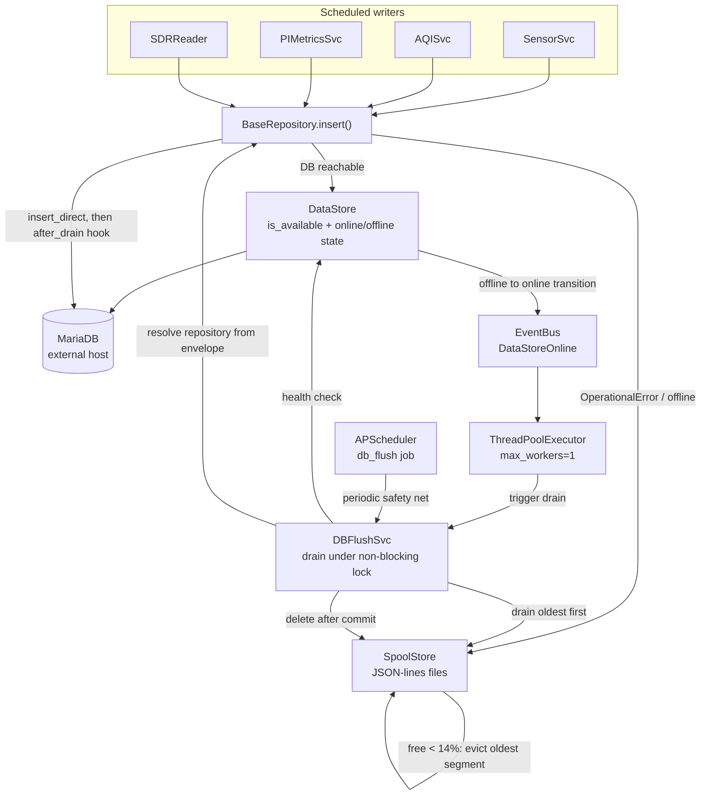

# Offline Spool Store, UTC Convention, and DB Backup Removal

Prepares WeatherWatch for the database moving to an external host. The move itself is owned by
[home_server `weather-mariadb-migration`](https://github.com/tim-oe/home_server/blob/main/.cursor/plan/weather-mariadb-migration.md);
this plan is the station-side work that migration surfaced or made necessary.

Three pieces. Phase numbers below are stable labels; the **execution order** is 1, then 3-7 with their tests and verification, then 2 once the migration's gate clears:

1. **Remove the in-app DB backup** (Phase 1). home_server's offen sidecar owns dumps now. Independent; lands any time.
2. **Add an offline spool** (Phases 3-7). With the database across the LAN, an unreachable DB must no longer mean lost readings. Nothing in it depends on the DB being remote: it builds and verifies against the local MariaDB exactly as it will run against the external one, and stopping the local service is a complete outage drill. So it lands and is proven **before** the migration cuts over, giving home_server a station that already tolerates the connection drop its Phase 3 asks about, rather than one that is retrofitted afterwards.
3. **Adopt piSolar's UTC convention** (Phase 2). The migration audit found an annual DST defect and a hidden dependency on the station's system timezone. Gated by the migration; deployed only when the spool directory is empty.

Phase 1 first is structural: removing the backup deletes `BackupRange.py` (one of the UTC read-side touchpoints) and frees `BaseRepository` of its DB-dependent constructor. Spool before UTC is a scheduling choice, and it has one consequence that shapes Phase 4: the spool codec must be **convention-agnostic**. It passes naive datetimes through unchanged, so a spooled `read_time` means whatever the entity meant when it was spooled, and the ORM applies whichever convention is live at replay. The straddle risk - a file written under naive-local replayed under naive-UTC - is closed procedurally: Phase 2 deploys only when the spool is empty, which it is whenever the DB is up.

## Decisions locked in

- Local store format: **JSON-lines spool files** on disk, one directory per table, serialized from the entity objects themselves via the SQLAlchemy mapper.
- Offline tolerance: **full** - `sensor.py` boots and collects even if the DB is unreachable at startup.
- Reads during an outage: **degrade gracefully** - return `None`/`[]`, callers log a warning and skip.
- Replay: **event-triggered plus a periodic `db_flush` APScheduler job**. An offline-to-online transition on the first successful write fires a `DataStoreOnline` event that kicks an immediate drain; the scheduled job is the safety net. Both drain oldest-first and delete only after a confirmed commit.
- Backup removal: **DB backup only**. Camera/timelapse rsync and local purge stay in `BackupSvc`.
- UTC convention: **adopt piSolar's pattern and remove `LocalToUTCDateTime`** rather than reducing it. Every write site produces naive UTC via the already-existing `Converter.utcnow()`, so the decorator has nothing left to do.
- Sequencing: **spool lands first, before the migration cutover and before the UTC change.** Phases 3-7 have no dependency on where the DB lives and are verified against the local MariaDB by stopping it; Phase 2 is gated on the migration and additionally requires an empty spool at deploy time.
- Spool capacity: **disk is the only limit.** Keep `min_free_pct` (14%) of the filesystem free; when an append would breach it, evict the oldest segment across all tables until it fits - newest row always wins. An outage may run indefinitely while disk allows; the operational target of under a day is a warning threshold, not a limit.
- Spool extensibility: **everything lives on `BaseRepository`.** Buffering, encode/decode, replay and the `after_drain` hook are inherited; the envelope carries the owning repository's dotted path so the drain resolves it with no central map. A new entity plus repository adopts the whole mechanism with no other change.
- Display timezone: **host zone via `tzlocal`** for `utc_to_local()` and `local_day_bounds()`. The dashboard and the station share the Pi; no new config. After Phase 2 the host zone affects presentation and local-day buckets only, never stored bytes.
- `get_days_rainfall`: **fixed to local-day bucketing.** The current UTC-day behaviour is a bug, not a convention to preserve; the WU `dailyrainin` and the dashboard gauge change accordingly.

## Current blockers to offline operation

Two constructors need a live DB connection today, so the process cannot even start during an outage:

- `BaseRepository.__init__` calls `DataStore.get_table_def()`, which runs `metadata.reflect(engine)`:

```39:45:weatherwatch/repository/BaseRepository.py
        self._table: Table = self._datastore.get_table_def(self._entity.__tablename__)

        self._columns = {}
        c: Column

        for c in self._table.columns:
            self._columns[c.name] = c.type
```

- `SchedulerSvc.__init__` builds a MariaDB-backed job store:

```113:114:weatherwatch/svc/SchedulerSvc.py
        self._jobstore = SQLAlchemyJobStore(url=AppConfig().database.url)
        jobstores = {"default": self._jobstore}
```

Removing the DB backup is what unblocks the first one: `get_insert()`/`get_value()` exist only to serve the repository `backup()` methods, and they are the only consumers of `_table`/`_columns`.

## Architecture



---

## Phase 1: Remove the database backup

Delete outright:
- [weatherwatch/backup/BackupRange.py](weatherwatch/backup/BackupRange.py) and the `weatherwatch/backup/` package
- [tests/backup/test_BackupRangeTest.py](tests/backup/test_BackupRangeTest.py) and `tests/backup/`

Edit [weatherwatch/svc/BackupSvc.py](weatherwatch/svc/BackupSvc.py):
- Drop `db()`, `outdoor_sensor_backup()`, `indoor_sensor_backup()`, `aqi_sensor_backup()`, `db_backup()`, `archive_monthly()` (lines 97-207)
- Drop `_backup_pool`, `_db_m_dir`, `_db_w_dir` from the ctor and the `BackupRange`, `ThreadPoolExecutor`, `concurrent`, `functools`, `glob`, `zipfile`, and three repository imports
- Keep `camera()`, `backup_stills()`, `backup_vids()`, `Rsync`

Edit [weatherwatch/svc/SchedulerSvc.py](weatherwatch/svc/SchedulerSvc.py):
- Remove `db_backup()` entry point (lines 61-66), `DB_BACKUP_JOB`, `init_backup_db()`, and its `__init__` call

Edit repositories - remove the `backup()` method from [OutdoorSensorRepository.py](weatherwatch/repository/OutdoorSensorRepository.py), [IndoorSensorRepository.py](weatherwatch/repository/IndoorSensorRepository.py), [AQISensorRepository.py](weatherwatch/repository/AQISensorRepository.py), [LightSensorRepository.py](weatherwatch/repository/LightSensorRepository.py). Then remove `get_insert()` and `get_value()` from [BaseRepository.py](weatherwatch/repository/BaseRepository.py) (lines 155-204) and the now-unused `insert`/`Numeric`/`Integer`/`DateTime`/`json` imports.

Config cleanup:
- [weatherwatch/conf/BackupConfig.py](weatherwatch/conf/BackupConfig.py) - remove `DB_KEY`, `WEEKLY_OLD`, `db_enable`, `db_weekly_old`
- [config/weatherwatch.yml](config/weatherwatch.yml) - remove the `backup.db` block (lines 18-20) and `scheduler.db_backup` (lines 80-81)
- [weatherwatch/conf/SchedulerConfig.py](weatherwatch/conf/SchedulerConfig.py) - remove `DB_BACKUP_KEY` and `db_back_hour`
- [weatherwatch/conf/DatabaseConfig.py](weatherwatch/conf/DatabaseConfig.py) - remove the orphan `BACKUP_KEY`/`ENABLE_KEY`/`FOLDER_KEY` constants and `backup_enable`/`backup_folder` (lines 29-31, 94-109); these read `database.backup.*`, which is not in the YAML at all

Test cleanup: [tests/svc/test_BackupSvcTest.py](tests/svc/test_BackupSvcTest.py) (drop the two DB tests, keep file tests), [tests/svc/test_SchedulerSvcTest.py](tests/svc/test_SchedulerSvcTest.py), [tests/conf/test_MiscConfigTest.py](tests/conf/test_MiscConfigTest.py), [tests/conf/test_DatabaseConfigTest.py](tests/conf/test_DatabaseConfigTest.py), the four `test_*RepositoryTest.py` backup tests, and `test_get_value_false_bool_returns_zero` in [tests/repository/test_OutdoorSensorRepositoryTest.py](tests/repository/test_OutdoorSensorRepositoryTest.py).

Also update the feature bullet in [README.md](README.md) (line 31) and note in `docs/` that DB backup is owned by home_server.

### 1b. Make the surviving camera backup safe

Reading the kept code closely while removing the DB half surfaced two defects in it, both of which matter more once the NAS and the DB share a host and go down together:

```43:53:weatherwatch/util/Rsync.py
            try:
                p.wait(timeout=60 * 5)
                self.logger.info("rsync subprocess complete %s", p.returncode)
                # for line in p.stdout:
                #     self.logger.debug(line.strip())

                # for line in p.stderr:
                #     self.logger.error(line.strip())
            except TimeoutExpired:
                self.logger.exception("rsync timed out")
                p.kill()
```

- **`Rsync.archive()` cannot fail.** A non-zero return code is logged at info and execution continues; a timeout is logged and swallowed. `BackupSvc.backup_stills()`/`backup_vids()` then run `Rsync.purge()` unconditionally, so during a NAS outage longer than `img_old` (14 days) images are deleted locally that were never archived anywhere.
- **Nothing checks the destination is actually the NAS.** `WW_BACKUP_FOLDER=/mnt/backup/weather` is a path, and if the mount is absent that path is a plain directory on the root filesystem. rsync will happily fill it. On this host that is the same filesystem as the spool, so an unmounted NAS plus a long outage would eat the 14% floor with image copies and trigger spool eviction for a reason that has nothing to do with the database.

Changes:
- [weatherwatch/util/Rsync.py](weatherwatch/util/Rsync.py): `archive()` returns `bool` - `False` on non-zero `returncode` or `TimeoutExpired`, logged at error with the return code. Re-enable stderr capture so the rsync error text makes it into the log.
- [weatherwatch/svc/BackupSvc.py](weatherwatch/svc/BackupSvc.py): add a `_dest_ready(path) -> bool` check run once per `camera()` call before anything else. The NAS is a TrueNAS NFS export, which dictates the mechanics:
  - **Find the mount without touching it.** Do not walk `Path.is_mount()` up from the folder - `is_mount()` is `lstat`, and `lstat` on an NFS mount point whose server is unreachable blocks for as long as the mount's `timeo`/`retrans` allow (indefinitely on a default `hard` mount). Parse `/proc/self/mountinfo` instead: take the longest mount-point prefix of `Path(folder).resolve()` and require its fstype to be `nfs` or `nfs4`. That is a local read and answers "is the NAS mounted over this path" with no network I/O.
  - **Probe writability in a killable subprocess.** The one operation that must touch the NAS is the write probe. Do it as `subprocess.run(["touch", probe], timeout=10)` followed by an unlink the same way, not an in-process `open()`: a Python thread blocked in NFS I/O cannot be interrupted, but a child process can be `SIGKILL`ed even on a `hard` mount (fatal signals have been honoured on hard NFS mounts since kernel 2.6.25). Treat a timeout as not-ready. The existing `Rsync.archive()` 5-minute `p.kill()` relies on the same property.
  - If either fails, log at error, send one `Emailer` alert per failure streak (latch; reset on the next success), and return without archiving **or purging**. The message is built entirely from runtime values - the configured `backup.folder` as given, the path `Path.resolve()` produced from it, and the fstype `mountinfo` reported for that path (e.g. `backup folder 'backup' resolved to '<cwd>/backup' on 'ext4', expected nfs`). No path literals in the app. The point is that `backup.folder` defaults to the relative `backup` and is only made absolute by `WW_BACKUP_FOLDER` in the systemd unit, so a process started without that env var resolves under the working directory on the SD card; showing the configured value next to the resolved one makes that misconfiguration recognisable at a glance rather than reading as a NAS outage.
  - No new path property. The mount is derived from `backup.folder` (`/mnt/backup/weather` resolves to the `/mnt/backup` NFS mount). Add one boolean, `backup.require_mount` (`WW_BACKUP_REQUIRE_MOUNT`, default `true`), so dev - where `backup.folder` defaults to a relative local `backup/` directory - can set it `false` and keep exercising the rsync path against a local target. The systemd unit leaves it at the default.
  - **Before this lands, confirm the unit file value against the station.** `/mnt/backup/weather` appears only in [systemd/weatherwatch.service](systemd/weatherwatch.service) line 20; the mount itself is provisioned by piImage, not this repo. Every other NAS path in the tree (`scripts/*.sh`, `setup.py`, the timelapse test) uses `/mnt/clones/...`, and the dev Pi mounts `tec-truenas:/mnt/main/clones` at `/mnt/clones` with no `/mnt/backup` at all. Run `grep nfs /proc/mounts` on tec-weather: if `/mnt/backup` is a real export, nothing changes; if the camera backup has in fact been landing in a plain `/mnt/backup/weather` directory on the SD card, correct the unit file to the mounted path and expect the first gated run to confirm it. The YAML default stays as it is either way - the deployment path belongs in the unit, not the repo config.
  - Worth checking in the piImage mount definition rather than here: a backup target is the textbook case for `soft,timeo=150,retrans=3` or at least an explicit `timeo` on a `hard` mount, so a NAS outage fails rsync in minutes instead of hanging it until the 5-minute kill. That is a client fstab/ansible change, not an app change, and the gate above works either way.
- `backup_stills()`/`backup_vids()`: call `purge()` only when `archive()` returned `True`. The local copy is the only copy until rsync confirms otherwise.
- Tests: `tests/svc/test_BackupSvcTest.py` gains cases for not-mounted, wrong-fstype, probe-timeout, not-writable, `require_mount=false` bypass, and archive-failure-skips-purge (inject `mountinfo` text and patch `subprocess.run`); new `tests/util/test_RsyncTest.py` asserts the return value against a stub command that exits non-zero and one that hangs past a short timeout. `Rsync.py` and `BackupSvc.py` are on the coverage omit list today (pyproject lines 102, 105); take them off once these tests exist.

This stays in Phase 1 because it is the same file being edited for the same reason, and because it is what makes the Capacity statement in Phase 4 ("the spool is the only unbounded local writer") actually true rather than true only while the NAS is mounted.

---

## Phase 2: Adopt piSolar's UTC convention

Analysis and rationale live in the migration plan's
[handoff section](https://github.com/tim-oe/home_server/blob/main/.cursor/plan/weather-mariadb-migration.md#handoff-weatherwatch-should-adopt-pisolars-utc-convention).
Every claim in it was re-verified against the current tree while writing this plan. Summary of what is wrong today:

**The DST defect.** `LocalToUTCDateTime.process_bind_param` uses `localize(value, is_dst=False)`. On the first Sunday of November, 01:00-01:59 local occurs twice in America/Chicago and `is_dst=False` resolves both passes to standard time:

- 01:30 CDT (first pass) actually happened at 06:30 UTC but is stored as **07:30 UTC**
- 01:30 CST (second pass) actually happened at 07:30 UTC and is stored as 07:30 UTC

So first-pass readings are written an hour late *and* collide with the second pass on `UNIQUE KEY (read_time, sensor_id)`. `light_sensor` has `UNIQUE KEY (read_time)` with no sensor discriminator, so it is tighter still. `V1_2_1__outdoor_sensor.sql` documents this behaviour and judges it acceptable, but it was reasoning about a one-off historic backfill - the same code runs in production every November.

Separately, `Converter.to_utc` uses `is_dst=None`, which **raises** `AmbiguousTimeError` instead of silently shifting. Its only caller is `WUClient.py` line 50, so Weather Underground posts throw during that hour rather than mis-dating. Spring-forward needs no handling: `datetime.now()` never returns a local time that does not exist.

**The hidden host dependency.** `_local_tz` is resolved from the *application host's* zone at import time, so the station's system timezone is the conversion factor for every row written. piSolar reaches the same bytes on disk with no host dependency at all, which is why it is the reference implementation rather than WeatherWatch.

### 2a. Write side

Generate UTC at the source. `Converter.utcnow()` already exists, already returns exactly the naive UTC value needed, and is **dead code** - referenced only by `tests/util/test_ConverterTest.py`. That strongly suggests this direction was chosen once and left half-finished:

```117:122:weatherwatch/util/Converter.py
    def utcnow() -> datetime:
        """
        current time as a naive UTC datetime for DB storage
        :return: naive UTC datetime
        """
        return datetime.now(timezone.utc).replace(tzinfo=None)
```

Replace `datetime.now()` with `Converter.utcnow()` at:
- [weatherwatch/svc/SensorSvc.py](weatherwatch/svc/SensorSvc.py) line 73 - the light sensor path
- [weatherwatch/svc/AQISvc.py](weatherwatch/svc/AQISvc.py) line 56
- [weatherwatch/svc/PIMetricsSvc.py](weatherwatch/svc/PIMetricsSvc.py) line 106
- [weatherwatch/sensor/sdr/SDRReader.py](weatherwatch/sensor/sdr/SDRReader.py) lines 311 and 326 - `start_time` and `end_time`

**The SDR reading timestamp is the one case the app cannot disambiguate on its own.** `SensorSvc.set_base_data` copies `data.time_stamp` straight through, and that value comes from rtl_433's reported `time` field parsed as naive local wall clock:

```72:72:weatherwatch/sensor/sdr/BaseData.py
            o.time_stamp = datetime.strptime(raw["time"], BaseData.DATE_FORMAT)
```

with `DATE_FORMAT = "%Y-%m-%d %H:%M:%S"`. During the fall-back hour that string is genuinely ambiguous and no client-side rule recovers the right answer - the information is not in the data. Fix it at the source instead: add `-M time:utc` to `SDRReader.CMD_BASE` so rtl_433 emits UTC directly.

Verified against the deployed build (`rtl_433 version 25.12-92`, `rtl_433 -M help`): `time:utc` changes only the zone, not the format. ISO-8601 is the separate `time:iso` option, and `time:tz` is what appends an offset. So:
- `BaseData.DATE_FORMAT` stays `"%Y-%m-%d %H:%M:%S"`; the parsed value is simply UTC now.
- The JSON fixtures in `data/` and `tests/data/` do not need regenerating. The `time` value inside the stored `raw` JSON column becomes UTC going forward, which is an improvement since it now agrees with `read_time`; `raw` is an archive column that nothing reads structurally.
- Use the `time:utc` spelling, not the legacy bare `utc` alias, so the intent is unambiguous against the current option grammar.

### 2b. Persistence layer

**Remove `LocalToUTCDateTime`** and let the time columns be plain `DATETIME(6)`, as piSolar's models are. With every write site producing naive UTC, the decorator has nothing left to do. The Phase 4 codec already unwraps `TypeDecorator` and passes naive datetimes through, so it needs no change here beyond dropping the now-dead unwrap branch if desired. It is referenced by `BaseSensor`, `AQISensor`, `LightSensor`, `PIMetrics` and `SDRMetricts`.

`tests/entity/test_LocalToUTCDateTimeTest.py` asserts the convention being replaced - including `test_bind_dst_fallback_picks_cst`, which encodes the bug as expected behaviour - so it goes with the decorator. Its offset-sanity cases are worth keeping in spirit as tests on the new local-day boundary helper.

**No schema migration.** Stored values are UTC today and stay UTC; this changes only which side of the persistence boundary performs the conversion. Nothing in `sql/schema/` changes and no data is rewritten. Rows already corrupted by past DST collisions are not recoverable and are out of scope.

### 2c. Read side

This is the part with real size. Today the decorator converts *filter bounds* on `read_time > :dt` comparisons as well as stored values, so the 7-day windows are self-consistent by accident. Once reads return UTC, every local-day boundary has to be computed explicitly, and every `read_time` shown to a human has to be converted back.

Both helpers below resolve the zone with `tzlocal.get_localzone_name()`, the same source `LocalToUTCDateTime._local_tz` uses today. The dashboard and the station share the Pi, so this introduces no new configuration; the difference from today is that the host zone now affects only what is *shown* and how a local day is *bucketed*, never what is *stored*.

**Filter bounds.** Add a single tested helper rather than repeating the arithmetic at each call site - `Converter.local_day_bounds(d) -> (utc_start, utc_end)` - then use it at:
- [weatherwatch/dashboard/page/OutdoorSensorPage.py](weatherwatch/dashboard/page/OutdoorSensorPage.py) lines 49 and 53 - `get_days_rainfall(date.today())` and a 7-day window
- [weatherwatch/dashboard/page/IndoorSensorPage.py](weatherwatch/dashboard/page/IndoorSensorPage.py) line 46 - 7-day window
- [weatherwatch/dashboard/page/AirQualityPage.py](weatherwatch/dashboard/page/AirQualityPage.py) line 39 - 7-day window
- [weatherwatch/svc/WUSvc.py](weatherwatch/svc/WUSvc.py) line 60 - `get_days_rainfall(date.today())`, a local-day rainfall total

**`get_days_rainfall` is already wrong and must change inside the repository, not just at its callers.** It compares `cast(OutdoorSensor.read_time, DATE) == rain_date`, and because the left side is cast to `DATE` the bind is a plain `DATE` - `LocalToUTCDateTime.process_bind_param` never runs. The dashboard rain gauge and the WU `dailyrainin` therefore sum the *UTC* calendar day today, so rain between roughly 18:00/19:00 local and midnight lands in the next day's total. Rewrite it to take the UTC bounds and filter `read_time >= utc_start AND read_time < utc_end` (dropping the `group_by`); the two callers above then pass `local_day_bounds(date.today())`. This is a deliberate behaviour change and the verification section accounts for it.

**Display.** `process_result_value` currently converts UTC back to local on read, so once the decorator is gone every surfaced `read_time` is UTC. Add `Converter.utc_to_local(dt)` and apply it at:
- `OutdoorSensorPage.py` line 47, `IndoorSensorPage.py` line 41, `AirQualityPage.py` line 37 - the page header timestamps
- [weatherwatch/dashboard/component/Graph.py](weatherwatch/dashboard/component/Graph.py) line 49 - the x-axis of every 7-day chart
- [weatherwatch/wu/WUClient.py](weatherwatch/wu/WUClient.py) line 50 - **the opposite direction**: `Converter.to_utc(read_time)` currently localizes a naive-local `read_time` to UTC for the `dateutc` field. After Phase 2 `out_data.read_time` is already naive UTC, so leaving this call in place would shift every WU post by another 5-6 hours. Pass `read_time` straight through; `Converter.to_utc` then has no callers and goes (which also removes the `AmbiguousTimeError` path noted above).

A local day is not a UTC day, so getting this wrong shifts totals by a few hours' worth of readings rather than failing loudly. That is the argument for helpers with their own tests instead of open-coded conversions.

`BaseRepository._coerce_to_datetime` exists solely to feed bare `date` objects into the decorator and should become unnecessary once callers pass explicit UTC bounds - remove it if nothing else needs it.

Things that look like read-side work but are not:
- `weatherwatch/backup/BackupRange.py` is on the handoff's list, but Phase 1 deletes it, so it drops off entirely.
- `CameraPage.py` line 51, `Timelapse.py` line 56 and `SampleLoader.py` use `date.today()` to build file-name stamps and dev fixtures, not DB filters. `CameraPage` touches no repository at all.

`aqi_clean` needs no attention - it is `id`-ordered throughout with no time functions.

### 2d. Documentation correctness

- `types.py` carries a stale docstring claiming "On read: returns the value as-is (naive UTC)" while `process_result_value` converts UTC back to local. It goes with the file, but note it so the same wording does not get carried into whatever replaces it.
- `sql/schema/V1_3_6__sonic_reading.sql` says SonicModBus "will be updated to set `read_time` explicitly from the application layer via the `LocalToUTCDateTime` TypeDecorator, consistent with the WeatherWatch UTC storage convention." That convention is the one being replaced, so correct the comment to point at piSolar's pattern before it propagates into a third writer. This is also on the migration's Phase 4 list.

---

## Phase 3: Make startup DB-independent

[weatherwatch/repository/DataStore.py](weatherwatch/repository/DataStore.py):
- Delete `get_table_def()` (reflection). Update [tests/repository/test_DataStoreTest.py](tests/repository/test_DataStoreTest.py).
- Add `connect_args={"connect_timeout": n, "read_timeout": n, "write_timeout": n}` and `pool_recycle` to `create_engine`. Critical now that the DB is across the network - a dead host would otherwise block a sensor read for the full TCP timeout. `connect_timeout` alone does not bound a half-open connection, and `pool_pre_ping` can hang on one, which is what the read/write timeouts are for. Both `mariadbconnector` (prod) and `pymysql` (tests) accept all three.
- Add `is_available() -> bool` running `SELECT 1`.
- Add offline-state tracking with a retry-after window (`_offline_until`) and an `is_offline()` accessor, so a long outage does not pay a connect timeout on every single insert or read; sensor handlers fire several times per cycle and `handle_outdoor` reads before it writes.
- Own the online/offline **state transition**: `mark_offline()` and `mark_online()`, where `mark_online()` fires the `DataStoreOnline` event only when the previous state was offline (see Phase 7). Guard the state with a `threading.Lock` - writes arrive from the SDR data pool, the light read, and the scheduler threads concurrently. Fire the event *after* releasing the lock, never while holding it.
- While in here, fix the swapped arguments - `max_overflow` is currently fed `pool_size` and vice versa (lines 30-31). Both are 3 in the YAML so this is a latent rather than live bug.

[weatherwatch/repository/BaseRepository.py](weatherwatch/repository/BaseRepository.py):
- Delete `self._table` and `self._columns` from the constructor outright. Phase 1 removes `get_insert()`/`get_value()`, their only consumers, and the Phase 4 codec reads `type(o).__table__.columns` directly, so there is nothing left to derive them for.

[weatherwatch/svc/SchedulerSvc.py](weatherwatch/svc/SchedulerSvc.py):
- Swap `SQLAlchemyJobStore` for `MemoryJobStore`. Every job is re-added on each startup with `replace_existing=True`, so MariaDB persistence buys nothing except the stale-job problem the `remove_job()` calls work around.
- With a memory store those `else: self._jobstore.remove_job(...)` branches in `init_camera`, `init_timelapse`, `init_backup_file`, `init_aqi`, `init_wu` become dead - remove them along with `self._jobstore` and the `JobLookupError` import, and update the corresponding tests.
- `__init__` calls `init_wu()` twice (lines 145 and 150). Harmless under `replace_existing=True`, but drop the duplicate while editing the block.
- The `apscheduler_jobs` table then goes unused. Leave the migration in place; dropping it belongs to home_server.

---

## Phase 4: Local spool store

New `weatherwatch/spool/SpoolStore.py`. Layout: `{spool.folder}/{table_name}/{YYYYMMDDTHH}.jsonl` - **hourly segments**, append-only, one JSON object per line. Hourly rather than daily because the segment is the unit of eviction (see Capacity below); dropping an hour of one table to make room is tolerable, dropping a day is not. Each line is an envelope so a drained line rebuilds a fully typed entity instance *and* knows which repository persists it:

```json
{"repository": "repository.OutdoorSensorRepository.OutdoorSensorRepository", "entity": "OutdoorSensor", "spooled_at": "2026-09-02T21:05:11+00:00", "data": { }}
```

`SpoolStore` itself knows nothing about tables or entities. Its API is `append(table, envelope_line)`, `segments(table)`, `claim_oldest(table) -> .draining path`, `release(path)`, and the capacity check. Everything that understands entities and repositories lives in `BaseRepository` (Phase 5), which is what makes a new repository pick the whole thing up for free.

### The repository is self-describing in the envelope

The drain must know which repository to replay a row through, and that must not be a hand-maintained map in the flush service - a map is exactly the thing a new entity's author forgets to update. Instead `BaseRepository._spool()` writes its own dotted class path (`f"{type(self).__module__}.{type(self).__qualname__}"`) into every envelope. On replay the flush service does `importlib.import_module(module)` + `getattr(cls)` and calls the class; repositories are `@singleton`, so that returns the live instance if one exists or constructs it if the owning service was disabled in this process. Two guards:
- the resolved repository's `entity.__tablename__` must equal the directory name the line was read from, otherwise the line is quarantined to `{table}/rejected.jsonl` with the reason and the drain continues;
- the module must resolve under the `repository.` package - a path anywhere else is rejected rather than imported.

The entity class comes from the resolved repository (`repo.entity`), so the `entity` field is informational and a cross-check, not the resolver.

### Entity serialization

Serialization is driven off the entity objects themselves, in a new `weatherwatch/spool/EntityCodec.py` (or as `to_json_dict()`/`from_json_dict()` on a small mixin shared by `BaseSensor` and `BaseEntity`). One generic codec covers every entity; no per-table field lists to keep in sync.

**Do not use `dataclasses.asdict()`.** The entity classes are inconsistently decorated and the dataclass field set is wrong:

- `OutdoorSensor`, `IndoorSensor`, `LightSensor`, `PIMetrics`, `SDRMetrics` carry `@dataclass`, but their bases (`BaseSensor`, `BaseEntity`) do not. Dataclass fields therefore cover only the subclass columns - `dataclasses.fields(OutdoorSensor)` returns just the 8 outdoor columns and **silently drops `read_time`, `battery_ok`, `sensor_id`, `temperature_f`, `humidity`, and `raw`**.
- `AQISensor` has no `@dataclass` at all, so `asdict()` raises `TypeError`.

The SQLAlchemy mapper has the complete and correct set for all six entities with no DB round trip, so drive the codec off `cls.__table__.columns` (verified against all entity types):

```python
# encode
data = {c.name: encode(getattr(o, c.name)) for c in type(o).__table__.columns if c.name != "id"}

# decode
ent = cls()
for c in cls.__table__.columns:
    if c.name in data and c.name != "id":
        setattr(ent, c.name, coerce(c.type, data[c.name]))
```

`id` is excluded in both directions - it is autoincrement and must not be replayed.

**Dispatch on the column type class, not `python_type`.** Checked against the installed SQLAlchemy: `Numeric`, `Integer` and `Boolean` resolve `python_type` cleanly, but `JSON().python_type` returns `object`, and so does `LocalToUTCDateTime` (it returns `object` rather than raising). So `python_type` cannot drive the codec on its own in either phase order. Use an `isinstance(c.type, ...)` match over `DateTime`, `Numeric`, `Integer`, `Boolean`, `JSON`, unwrapping a `TypeDecorator` through `c.type.impl` first. That one unwrap line is what lets the codec work with `LocalToUTCDateTime` still in place, which is required now that the spool lands before Phase 2.

**Coerce by column type, not by the value's Python type.** At spool time the entity has not been through `commit()`/`refresh()`, so its attributes are whatever the service assigned: `rain_cum_mm = data.rain_mm` (float from rtl_433 JSON), `pressure = bmp.pressure` (float), `temperature_f` (float). A codec that only special-cases `Decimal` values will emit floats for these. Encode every `Numeric` column as `str(value)` regardless of the incoming type, and decode to `Decimal`. The round-trip tests in Phase 8 must build entities the way the services do (floats), not with `Decimal`s, or they will pass while production does not.

On the wire, `Numeric` encodes as a string (never a float - these are rainfall and pressure values) and `DateTime` as **naive `isoformat()` with no offset, passed through unchanged in both directions**. This is deliberate and follows from landing the spool before Phase 2: before Phase 2 the entity's `read_time` is naive local and the decorator converts at bind; after Phase 2 it is naive UTC and nothing converts. A codec that stamps `+00:00` on the value would be lying in the first regime. Passing the naive value through means a replayed entity is indistinguishable from a freshly built one, and the ORM applies whichever convention is live. Decode rejects an offset-bearing string rather than silently stripping it, so a future change cannot sneak a tz-aware value in. Once Phase 2 has landed, adding the explicit `+00:00` for self-description (piSolar's choice in `services/sqlite_consumer.py`) becomes safe and is a one-line follow-up. `raw` is already a dict and passes straight through.

### Drain safety

The flush job and the writers touch the same directory, and the writers are concurrent - the SDR `_data_pool` has one worker per sensor, plus the light read and the APScheduler threads. So:
1. **Per-table `threading.Lock`, shared by append and rename.** Each append is open / write one line / flush+fsync / close under the lock; no long-lived file handles. Without this, a writer holding an fd across the rename appends to the `.draining` file after the drainer has read past that offset, and the line is deleted with the file.
2. Under the same lock, atomically `rename` the active file to `{name}.draining`, which sends new appends to a fresh file.
3. Replay lines from the `.draining` file in order (outside the lock - the drain is slow and must not block writers).
4. Delete the file only once every line is committed; on partial failure rewrite the remainder to a temp file and `os.replace` it back.
5. On startup, adopt any leftover `.draining` files (crash recovery).

### Capacity

The spool has no size limit of its own. The only constraint is disk: the filesystem holding `{spool.folder}` must keep at least `min_free_pct` (default **14%**) free. An outage may run indefinitely while that holds; the design target is that the DB is never down more than a day, but nothing in the code assumes it.

Before each append, `SpoolStore` checks `shutil.disk_usage(folder)`. If free space is below the floor, it **evicts oldest-first until the append fits**: the oldest segment by name across *all* table directories is deleted, repeat. The incoming row always wins over the oldest stored one. Rules:
- Never evict the segment currently being appended to, nor any `.draining` segment (a drain is in progress on it; its rows are about to leave anyway).
- Eviction is logged at error with the segment name and row count, and the first eviction of an outage sends one `Emailer` alert (latched, reset when the spool next drains to empty).
- A separate, earlier `Emailer` warning fires once per outage when the spool first exceeds a day's worth of data by age (oldest segment older than 24 h), since that is the operational target being missed, independent of disk.

Volume, for scale: roughly seven rows per five-minute cycle across the six tables at a few hundred bytes each is on the order of **1-2 MB per day**. The station's root filesystem is 117 GB with 96 GB free, so 14% is ~16 GB and the spool would need years of outage to reach it. The floor exists so a runaway cannot take the Pi down, not because a realistic outage approaches it.

**The spool is the only unbounded local writer.** The check is on *total* free space and the spool shares the filesystem with `/var/lib/weatherwatch/pix` and `/vid`, but those have a fixed maximum footprint: `BackupSvc.camera()` rsyncs them to the NAS and `Rsync.purge()` deletes local files older than `backup.purge.img_old` (14 days) and `vid_old` (90 days) on every `file_backup` run. The purge is unconditional on `purge_enable` - `Rsync.archive()` logs a non-zero return code rather than raising, so a NAS outage does not stop the purge - which means the camera's local footprint is bounded by those two windows regardless of network state. The steady-state camera usage therefore sits as a constant under the 14% floor, and anything that *grows* toward the floor is the spool. An eviction alert means exactly one thing: the DB has been down long enough to consume the free disk above the camera's fixed share.

That holds only if rsync is writing to the NAS and not into an unmounted `/mnt/backup` on the root filesystem - which is why Phase 1b gates the camera backup on the destination being a real, writable mount. Without that gate the two outages this plan is designed around (NAS and DB on the same host) would have rsync and the spool competing for the same disk.

### Config

New `weatherwatch/conf/SpoolConfig.py` plus registration in [weatherwatch/conf/AppConfig.py](weatherwatch/conf/AppConfig.py) (following the existing `BackupConfig` pattern), and a new `spool:` block in [config/weatherwatch.yml](config/weatherwatch.yml):

```yaml
spool:
  enable: !ENV tag:yaml.org,2002:bool ${WW_SPOOL_ENABLE:true}
  folder: !ENV ${WW_SPOOL_FOLDER:spool}
  # eviction floor: oldest segments are dropped to keep this much of the filesystem free
  min_free_pct: !ENV tag:yaml.org,2002:int ${WW_SPOOL_MIN_FREE_PCT:14}
  # operational target; exceeding it warns once per outage, it does not limit anything
  warn_age_hours: !ENV tag:yaml.org,2002:int ${WW_SPOOL_WARN_AGE_HOURS:24}
```

Add `WW_SPOOL_FOLDER` to [systemd/weatherwatch.service](systemd/weatherwatch.service) pointing at local storage (for example `/var/lib/weatherwatch/spool`) - it must not live on the NAS mount, since the whole point is surviving a network outage.

---

## Phase 5: Route writes through the spool

Wrap the single write funnel in [weatherwatch/repository/BaseRepository.py](weatherwatch/repository/BaseRepository.py):

```70:82:weatherwatch/repository/BaseRepository.py
    def insert(self, o: T):
        """
        insert new object
        :param self: this
        :param o: the object to insert
        """
        session: Session = self._datastore.session
        try:
            session.add(o)
            session.commit()
            session.refresh(o)
        finally:
            session.close()
```

becomes:

- If the datastore is known-offline (`is_offline()`, inside its retry-after window), spool immediately and return.
- Otherwise attempt the commit. On success call `DataStore.mark_online()`, which is a no-op unless it is an offline-to-online transition.
- On a **connection-class** error - `OperationalError`, `InterfaceError`, or any `DBAPIError` with `connection_invalidated` set - call `DataStore.mark_offline()`, spool the entity, and log a warning rather than re-raising.
- **Do not** treat every `SQLAlchemyError` this way. `IntegrityError` and `DataError` are `SQLAlchemyError` subclasses, and a live duplicate key (today's DST collision, or a repeated rtl_433 packet in the same second) would otherwise flip the store offline, spool a row that can never be delivered, and divert every subsequent write to disk until the retry window expires. Those keep today's behaviour: propagate to the caller's existing `except Exception` and log.
- Drop the `session.refresh(o)` after `commit()`. Nothing reads the generated `id`, and it is a second round trip that, if it fails after the commit succeeded, would spool a row that is already in the database.

Every production writer already funnels through here - `SensorSvc` (lines 82, 99, 143), `AQISvc` (line 58), `PIMetricsSvc` (line 108), `SDRReader` (line 379) - so no call-site changes are needed for buffering.

### Everything spool-related lives on `BaseRepository`

This is the extensibility requirement: a future `FooRepository(BaseRepository[Foo])` with a `Foo` entity must get offline buffering, replay, and the drain hooks with **zero additional code**, and nothing elsewhere in the tree should need to learn that `foo` exists. So the full surface is on the base class, keyed off `self._entity` and `self._entity.__tablename__`:

| Member | Role | Subclass override? |
|---|---|---|
| `insert(o)` | commit, or spool on connection-class failure (above) | no |
| `insert_direct(o)` | commit with **no** spool fallback, raises on failure; the replay path | no |
| `_spool(o)` | encode `o` via the codec, wrap in the envelope with this repository's dotted path, `SpoolStore.append(tablename, line)` | no |
| `spool_decode(data) -> T` | build an entity of `self._entity` from an envelope's `data` via the codec | no |
| `replay(entity)` | `insert_direct(entity)`, translating `IntegrityError` to "already delivered" | rarely |
| `after_drain(first_read_time)` | post-drain fix-up hook, default no-op | **yes**, when a table has derived columns |

`after_drain` is the one deliberate extension point. The rain-delta recompute (Phase 7) is `OutdoorSensorRepository.after_drain()`, not a special case in the flush service - the knowledge that `rain_delta_mm` is derived from the previous row belongs to the repository that owns the table. A future table with a similar derived column overrides the same hook.

`insert_direct()` exists because a failure mid-replay through the normal `insert()` would spool a row that is already sitting in the spool and duplicate it.

---

## Phase 6: Degrade reads

Add a `@db_read(default=None)` decorator in `weatherwatch/repository/` and apply it to the read methods on all six repositories (`find_by_id`, `top`, `find_latest`, `find_greater_than_read_time`, `get_days_rainfall`) so a connection-class DB error logs a warning and returns the default instead of propagating. It must also **short-circuit when `DataStore.is_offline()`** and return the default without touching the engine - `handle_outdoor` calls `find_latest()` before every outdoor insert, so without this each SDR event during an outage would still pay a full `connect_timeout` on the read even though the write is being spooled.

Guard the callers:
- [weatherwatch/svc/WUSvc.py](weatherwatch/svc/WUSvc.py) - return early with a warning when `in_data` or `out_data` is `None`. Important: the current broad `except Exception` at line 85 fires an error email, so without this guard an outage would email on every WU interval.
- [weatherwatch/svc/CameraSvc.py](weatherwatch/svc/CameraSvc.py) line 56 - skip weather EXIF tags when the latest reading is `None`; still take the photo.
- [weatherwatch/svc/AQISvc.py](weatherwatch/svc/AQISvc.py) line 62 - skip the `aqi_clean` stored procedure while offline.
- Dashboard pages [OutdoorSensorPage.py](weatherwatch/dashboard/page/OutdoorSensorPage.py), [IndoorSensorPage.py](weatherwatch/dashboard/page/IndoorSensorPage.py), [AirQualityPage.py](weatherwatch/dashboard/page/AirQualityPage.py) - render an empty/unavailable state rather than throwing.

---

## Phase 7: Flush service

New `weatherwatch/svc/DBFlushSvc.py` with a `process()` entry point, following the existing service pattern. It is a `@singleton` instantiated from `SchedulerSvc.__init__` so that its `EventBus.subscribe(...)` runs in the `sensor.py` process at startup; a subscription that nothing instantiates never fires.
1. Acquire a non-blocking re-entrancy lock; bail out if a drain is already running (see below).
2. Run `DataStore.is_available()`. Return immediately on failure. **On success call `DataStore.mark_online()`.** This is what closes the state machine: while the store is known-offline, `insert()` spools without touching the DB, so nothing else would ever observe recovery until the retry-after window expires. The health check in the periodic job is the second path back to online. If that `mark_online()` is a transition it fires `DataStoreOnline`, the event-driven drain hits the re-entrancy lock and returns, and the scheduled drain already in progress does the work - that is the intended outcome, not a bug.
3. Discover table directories **from disk** (`SpoolStore.tables()`), not from a list. For each, claim the oldest segment, and for each line resolve the repository from the envelope's dotted path (Phase 4 guards apply), `repo.spool_decode(data)`, `repo.replay(entity)`. Oldest-segment-first, oldest-line-first.
4. Treat `IntegrityError` on replay as delivered and drop the line - the sensor tables have unique constraints on `(read_time, sensor_id[, channel])`, so a crash mid-drain must not stall the queue forever. Log these at warning with a running count rather than silently: after Phase 2 a duplicate should only ever mean an interrupted drain, so a nonzero count for any other reason is worth seeing.
5. After a table's segments are all drained, call `repo.after_drain(first_replayed_read_time)` once. The flush service does not know or care which tables need it.
6. Log a summary (rows replayed per table, rejected lines, remaining depth).

The flush service therefore contains no table names, entity names, or repository names. Adding a seventh entity and repository changes nothing here.

### Two triggers

**Event trigger.** The codebase already has `python-event-bus`, and `SDRReader` establishes the pattern for firing an event without blocking the caller:

```228:234:weatherwatch/sensor/sdr/SDRReader.py
                if r is not None:
                    r.raw = json.loads(line)
                    r.config = sensor
                    reads.append(r)
                    # EventBus.call(evt, r)
                    se: SensorEvent = SensorEvent(evt, r)
                    self._data_pool.submit(se.fire)
```

Mirror it: `DBFlushSvc` subscribes to a `DataStoreOnline` event, and `DataStore.mark_online()` submits the `EventBus.call()` to a single-worker `ThreadPoolExecutor`. The thread pool matters - `EventBus.call()` dispatches subscribers **synchronously on the calling thread**, so firing it inline would run a full spool drain inside `BaseRepository.insert()` on the SDR data-pool thread and stall the sensor read cycle.

**Scheduled trigger.** Keep the `db_flush` APScheduler job as the safety net. It covers the case where the DB comes back but nothing tries to write for a while, and the case where a drain was interrupted partway.

### Guards this combination requires

- **Fire on transition only.** `mark_online()` emits nothing unless the previous state was offline. Without this, every successful write during normal operation would fire an event.
- **Non-blocking re-entrancy lock.** `drain()` itself calls `insert_direct()`, and the scheduled job and the event path can overlap. A `threading.Lock` with `acquire(blocking=False)` means a second trigger logs and returns instead of double-draining.
- **No spool fallback during replay.** Replay goes through `insert_direct()` so a mid-drain DB failure aborts the drain and leaves the remaining lines in the spool, rather than re-spooling rows that are already there.
- **Re-mark offline on replay failure.** If `insert_direct()` fails mid-drain, call `mark_offline()` so the next successful write fires a fresh transition event and resumes the drain.

### Rain delta correction

`SensorSvc.handle_outdoor` computes `rain_delta_mm` from `find_latest()`:

```125:126:weatherwatch/svc/SensorSvc.py
            if last_read is not None:  # edge will happen with new DB
                delta = round(Decimal(str(data.rain_mm)) - last_read.rain_cum_mm, 2)
```

With reads degraded, `last_read` is `None` during an outage and every buffered reading gets `rain_delta_mm = 0`, which would silently zero out daily rainfall since `get_days_rainfall()` sums that column. But the spooled rows are not the only ones that are wrong, and "recompute from the DB's current latest" is not the right starting point. Walk the timeline:

1. Pre-outage latest row is `R0`. The outage spools `R1..Rn`, each with `rain_delta_mm = 0`.
2. The DB returns. The first *live* row `L1` arrives through `insert()` before or during the drain and computes `delta = L1.cum - R0.cum` via `find_latest()`, because `R1..Rn` are not in the DB yet. `L1` now carries the entire outage's rain.
3. The drain replays `R1..Rn`. "The DB's current latest" is now `L1`, which is *after* them, so computing from it gives nonsense; and even computing from `R0` correctly double-counts the rain that `L1` already absorbed.

So the recompute must be a window, not a per-row lookup against `find_latest()`. Implement it as `OutdoorSensorRepository.after_drain(first_read_time)`, overriding the no-op on `BaseRepository`: select every row with `read_time >= first_read_time` in `read_time` order (this includes `L1` and anything after it), and re-derive `rain_delta_mm` for each from its predecessor's `rain_cum_mm`, seeding with the last row before the window. Reuse the existing sensor-reset guard for a negative delta. This is one `UPDATE` pass over a few hundred rows at most and makes the result independent of how live and replayed writes interleaved. The flush service calls the hook blindly on every drained repository; only this one does anything.

Register the job in [weatherwatch/svc/SchedulerSvc.py](weatherwatch/svc/SchedulerSvc.py) with a `db_flush` entry point and `DB_FLUSH_JOB` id, plus `scheduler.db_flush.interval` in the YAML and a `db_flush_interval` property on `SchedulerConfig`.

---

## Phase 8: Tests

**UTC convention.** `local_day_bounds` and `utc_to_local` need their own tests - CDT and CST offsets, and a local day that spans a UTC day boundary. Assert that the 7-day windows return the same rows before and after the change for a fixed fixture, since a few hours' drift is the failure mode here rather than an exception. For `get_days_rainfall` the assertion is the opposite: a fixture with rain at 20:00 local (01:00 UTC next day) must land in the local day's total, which it does not today. Add a `WUClient` test that `dateutc` equals the UTC `read_time` unshifted. A DST fall-back fixture is worth keeping as a regression test that the collision is gone.

**Spool and flush.** New `tests/spool/test_SpoolStoreTest.py` and `tests/spool/test_EntityCodecTest.py` (hourly rotation, `.draining` crash recovery, concurrent appends racing a rename, eviction - patch `shutil.disk_usage` to force the floor and assert the oldest segment across tables goes first and the active and `.draining` segments never do, alert latching, plus a round trip for **all six** entity types asserting every mapper column survives - this is the regression guard against the `dataclasses.asdict()` field-loss trap, and `AQISensor` and `OutdoorSensor` are the two that would catch it). Build the round-trip entities with the float values the services assign, not `Decimal`s. New `tests/svc/test_DBFlushSvcTest.py` (drain ordering, `IntegrityError` idempotency, repository resolution from the envelope including the two rejection guards, `after_drain` called exactly once per drained table, rain-delta window recompute including a live row written between recovery and drain, no-op when unavailable, re-entrancy lock rejects an overlapping drain). **An extensibility test**: define a throwaway entity and `BaseRepository` subclass inside the test module against a scratch table, force it offline, insert, drain, and assert the row lands - with no registration anywhere outside the test. That test is the contract for "new entities adopt it for free". In `tests/repository/`: the offline paths, and that `IntegrityError` on `insert()` neither marks offline nor spools.

**Event path.** Assert `mark_online()` fires `DataStoreOnline` only on a transition and not on repeated successful writes, and that a drain triggered by the event does not recurse when its own `insert_direct()` calls succeed.

The session-scoped MariaDB testcontainer in [tests/conftest.py](tests/conftest.py) is shared, so simulate outages by patching `DataStore.is_available`/`session` to raise `OperationalError` rather than stopping the container.

Removed with their subjects: `tests/entity/test_LocalToUTCDateTimeTest.py` (Phase 2b) and the DB backup tests (Phase 1). Phase 1b adds coverage for `BackupSvc.py` and `Rsync.py`, so remove both from the omit list in [pyproject.toml](pyproject.toml) (lines 102, 105) at that point; do not omit the new spool or flush modules.

---

## Phase 2 deploy precondition

Because the spool lands first and its codec passes naive datetimes through unchanged, a spool file written before Phase 2 holds naive-local `read_time` values. Replaying one after Phase 2 would store those bytes as UTC, several hours off. The guard is procedural:

1. Confirm the DB is reachable and `db_flush` has run (log line with zero remaining depth).
2. Confirm `{spool.folder}` contains no `.jsonl` or `.draining` files.
3. Deploy Phase 2 and restart `sensor.py`.

Step 2 is a hard stop, not a warning. Add it to the deploy notes alongside the migration's own gates.

## Coordination with the home_server migration

- **Sequencing.** The migration explicitly defers the UTC change until after its cutover, so that a genuine data discrepancy cannot be confused with an intended one by its gates. Phase 2 of this plan waits for the migration's Phase 3 to pass its seven-day G3 recheck. Phase 1 and Phases 3-7 are independent of the migration's schedule and land before it.
- **`WW_DB_BACKUP_ENABLE=false` becomes moot.** The migration's Phase 4 task list includes setting that flag on the station. Phase 1 here removes the `backup.db` config block entirely, so the env var stops being read at all. Whichever lands first, that task should be closed rather than actioned - worth telling home_server so it is not left looking unfinished.
- **The spool is what answers the migration's open question, and it is answered before cutover.** Its Phase 3 notes that a `docker compose up -d` on the mariadb stack drops every connection and says "confirm both clients reconnect rather than wedging their schedulers ... if either does not recover cleanly, that is an upstream fix in the app, not something this repo can paper over." Phases 3 through 7 are that fix, and the mid-run stop drill against the local MariaDB proves it on the station before the DB moves - the migration inherits a client that is already known to recover.
- **Phase 2 removes a station invariant the migration has to protect.** Its Gate G1 asserts tec-weather is still `America/Chicago` because that is currently the conversion factor for every row written. Once Phase 2 lands, the host zone only affects dashboard presentation, and that gate can be relaxed to a note.
- **The permanent `MIN(read_time)` sentinel is unaffected** by anything here - no phase rewrites historic rows.

## Verification

- `poetry run pytest` green
- `python3 setup.py lint` and `format` clean
- **Offline drill (after Phases 3-7, against the local DB, before the migration):** the local MariaDB is the test rig - stop it rather than faking a dead host. Dev: `python3 setup.py mysqlDown` / `mysqlUp`; station: `sudo systemctl stop mariadb` / `start mariadb`. Two scenarios, in this order:
  1. **Mid-run stop.** With `sensor.py` running and healthy, stop the DB. Confirm the next write marks the store offline (one warning, not one per row), subsequent reads short-circuit without paying `connect_timeout`, rows accumulate as JSON-lines, and `WUSvc`/`CameraSvc` degrade without error emails. Start the DB. Confirm the drain fires on the first successful write rather than waiting for the scheduled job, rows land with correct `read_time` and `rain_delta_mm` - including the first live row written after recovery - and the spool directory empties. This is a direct rehearsal of the `docker compose up -d` connection drop home_server's Phase 3 asks about.
  2. **Cold start.** With the DB still stopped, restart `sensor.py`. Confirm it boots, `SDRReader` and the scheduler come up, and readings spool from the first cycle. Start the DB and confirm the periodic `db_flush` health check (not a write) brings it back online and drains.
  The dead-`WW_DB_HOST` variant remains useful once the DB is remote, as it exercises a TCP black-hole rather than a connection refused, which is where the read/write timeouts matter.
- **UTC change (after Phase 2):** compare the 7-day charts, page header times and one WU payload before and after - these must be unchanged. The daily rainfall total (dashboard gauge and WU `dailyrainin`) is **expected to differ** on any day with evening rain, because it moves from UTC-day to local-day bucketing; confirm the new value matches a manual sum over the local day. Confirm `MIN(read_time)` per table is unchanged (the same sentinel the migration relies on).
